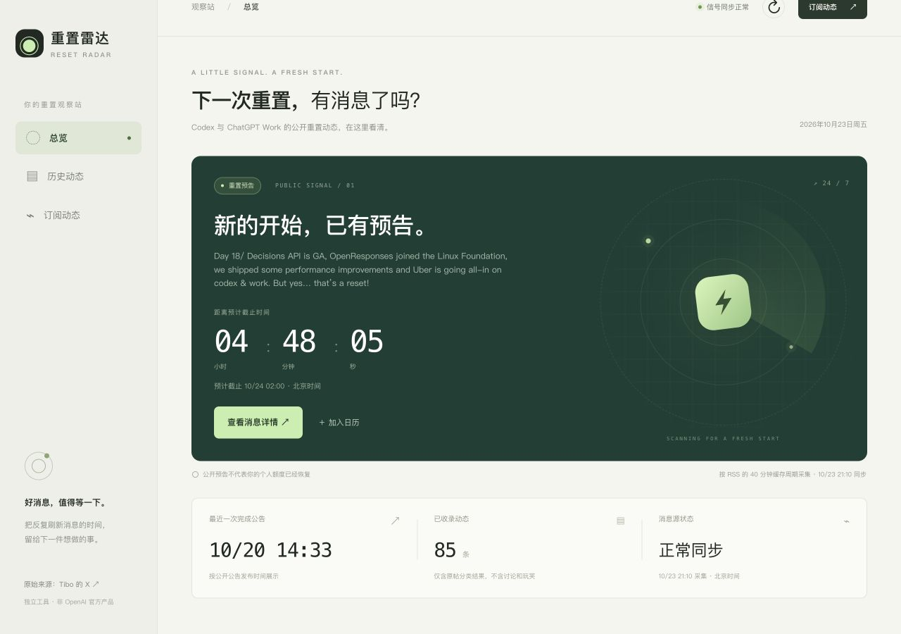
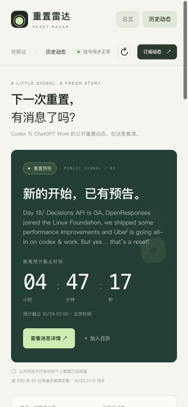

# 2026-10-23 页面与交付验收

站点：http://47.237.1.108/ 。线上代码版本：`6b73f3f`，对应 [v0.2.0](https://github.com/chenyi/reset-radar/releases/tag/v0.2.0)。

## 独立问题记录

| 问题 | 复现与结果 | 状态 |
|---|---|---|
| [#1 归档新查询跳过第一页](https://github.com/chenyi/reset-radar/issues/1) | 输入新搜索词后直接点继续查看，原来从旧 offset=20 开始。修复后从 10/23 的首条匹配原帖开始，第一页 20 条，继续加载得到 40 条、40 个不同链接。 | 已修复、线上通过 |
| [#6 关闭详情后的导航上下文](https://github.com/chenyi/reset-radar/issues/6) | 从总览打开并关闭详情，导航切换到历史动态。建议保持打开前入口及列表状态。 | 待所有者审批，本轮未修改 |

另外修正归档分类进度提示：1977/1977 已处理时显示“已完成当前归档分类，等待新帖”，不再一直提示正在分类。

## 页面实测

| 场景 | 结果 |
|---|---|
| 桌面 1280×900 | 总览、倒计时、来源和统计正常显示 |
| 手机 375×812 | 文档宽度与视口均为 375px，无横向溢出；订阅弹窗可打开关闭 |
| 分类 | 预告 29、完成 13、进展 31、重置卡 12、更正 0；每个筛选列表标签与选择一致 |
| 搜索 | 2026-10-23 匹配 2 条；无匹配时显示空状态 |
| 原文详情 | 主公告、时间补充、原帖链接与北京时间均显示，原文保留 |
| 归档 | 改条件再翻页从第一页开始；同条件继续加载无重复 |
| RSS/日历 | RSS 只含已分类原文；日历为当前有效预告，提前 15 分钟提醒 |
| 时间与来源异常 | 单元测试覆盖过期、来源不新鲜、新完成公告覆盖旧预告，时间经过不自动变成已完成 |

## 数据、服务与通知

- PostgreSQL 16 仅监听回环地址；公开 health 返回 `database=postgresql`。
- 7 张原业务表逐表逐值摘要一致：posts 1977、post_analyses 4295、reset_events 141、event_posts 404、collection_jobs 918、sync_state 7、ai_requests 146。61 个综合事件、85 条分类消息与切换前一致。
- PG dump 恢复至独立空库后，7 张表全部内容摘要一致。源码 bundle、原 SQLite 和迁移校验保存在服务器仓外备份目录。
- 服务器 52 项测试全部通过，含 PG 费用精度、并发预算预留、序列、事务回滚，以及通知去重、时间更正、取消、超时和重启状态。Node 真实归档加载函数回归通过。
- 线上 13 项数据、原文关联、历史范围、RSS 与日历验收通过。
- 网站与通知 worker 分别运行，启动后 NRestarts=0；通知登记采用历史基线，仅排入当前未来预告提醒，没有补发历史。
- v0.2.0 版本说明通过持久任务投递到配置的钉钉群，并在桌面客户端读回正文。未 @全员，未重复发送测试消息。
- 群公告通过“仅发布不通知”发布；DING、确认查收、新人必看未启用。群聊截图和机器人凭据不进入公开仓库。

## 边界

未来真实预告、完成和更正的自动通知仍依赖原消息源与分类结果；公开来源按 40 分钟 TTL 拉取，并非即时 X 推送。unknown 投递必须人工核查，不自动重发。微信和自动群聊需求收集尚未接入；需求由所有者手动发起整理、在 GitHub 审批。
