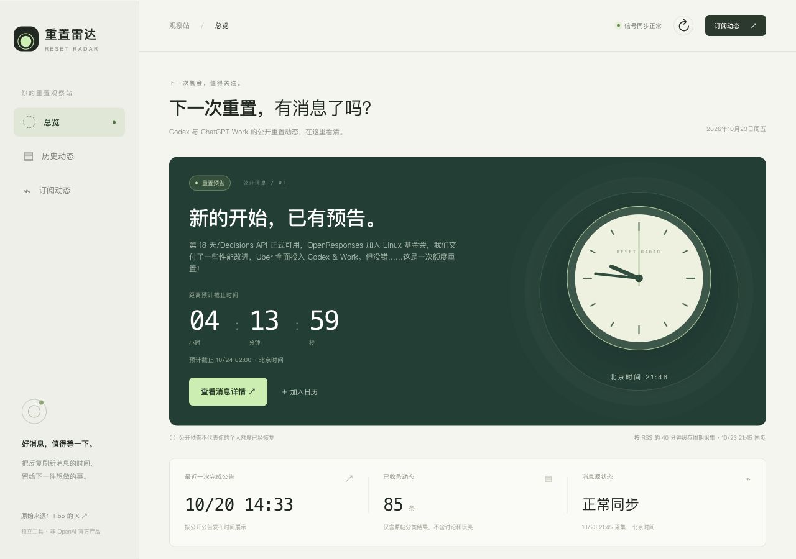
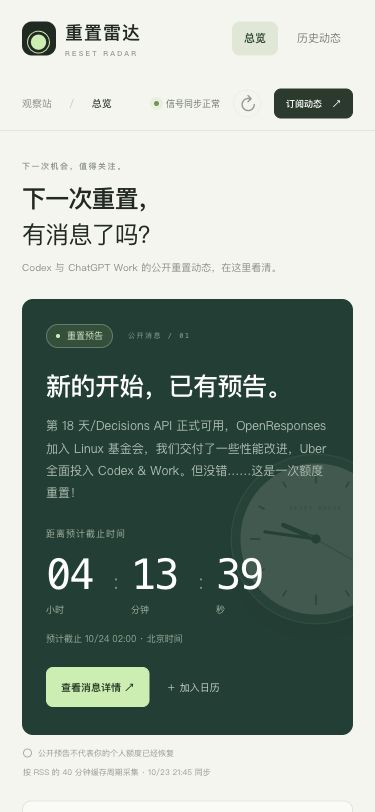

# v0.3.0 中文阅读与样式验收

2026-10-23 21:48（北京时间）验证。线上运行代码 `e8b2964`，对应 [PR #10](https://github.com/chenyi/reset-radar/pull/10)。

## 已验证

| 内容 | 实际结果 |
|---|---|
| 历史中文 | 85/85 条分类消息有中文；包含全部公开事件依据，共 131 条独立原帖译文。首页 Day 18、列表、详情和 RSS 使用中文。 |
| 原文与分类 | 1977 条采集原帖、61 个公开事件、85 条分类消息保留；展开详情可看到原英文。译文不用于判断状态、时间或范围。 |
| 翻译校验 | 拦截过模型重复原帖编号，拆小批次完成；普通 reset 与 banked reset 分别使用“额度重置”和“重置卡”。不重复调用已收到结果的请求。 |
| 桌面及手机 | 1280px 桌面展示指针时钟和实时北京时间；375px 手机文档宽度为 375px，无横向溢出。 |
| 搜索与详情 | 中文“额度重置”和英文“Decisions API”都可搜索，后者匹配 1 条；无匹配显示空状态。中文详情、展开原文与来源链接通过。 |
| 样式备选 | [/style-options](http://47.237.1.108/style-options) 共 9 张选项卡：通知、时钟、头像各 3 种；3 张头像图片加载完成。默认 A+A+A。 |
| 钉钉 | 重新打开机器人设置确认薄荷绿头像持久化；群内新消息也显示新头像。推荐中文通知以“样式预览 · 不是新公告”投递一次，记录为 sent、attempts=1，客户端读回正文与排版。未 @全员。群截图不进入公开仓库。 |
| 服务与回归 | 服务器 63 项测试全部通过，含 4 项真实 PostgreSQL 集成测试；Node 归档分页回归、13 项线上数据/RSS/日历检查通过。网站和通知进程 active，NRestarts=0。 |
| 费用保护 | 沿用个人百炼、新加坡模型、代金券核验和共享 50 元月预算；翻译请求的应用侧估算合计约 0.0295 元。此估算不等于已出账抵扣凭证，实际抵扣以阿里云流水为准。 |

## 保留的边界

原文归档、作者引用及社区注释按原始材料展示；译文使用独立表，原帖散列变化后旧译文失效。AI 翻译可能有措辞偏差，保留逐条核对原文的入口。备选页面的通知内容是静态样式示意。

[#6 关闭详情后的导航上下文](https://github.com/chenyi/reset-radar/issues/6) 仍待所有者审批，本轮未修改。机器人通知依赖公开来源和分类结果，预览消息不代表新增重置公告。
